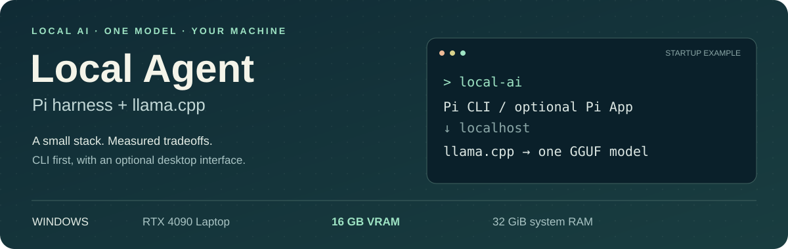
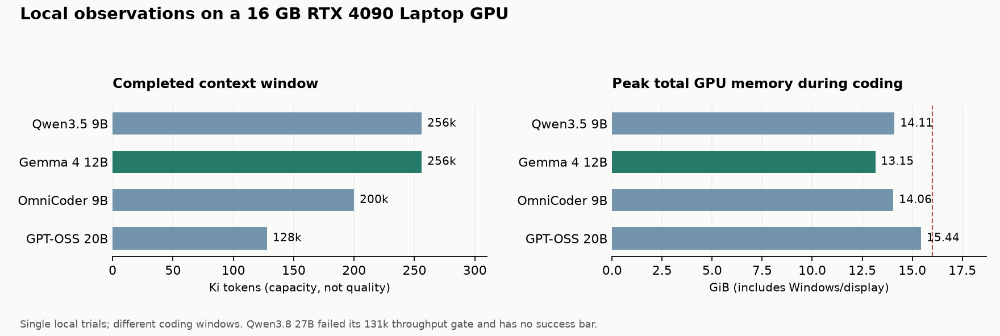
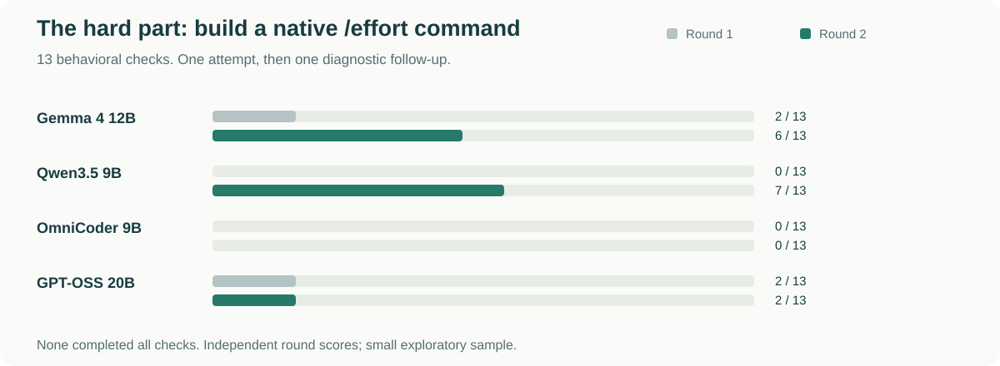

# local-agent-pi-llama-cpp-16gb

**A fully local AI coding-agent setup with the Pi harness + llama.cpp.** Developed on Windows with an **RTX 4090 Laptop GPU, 16 GB VRAM and 32 GiB RAM**. Optional Pi App, one-command startup, and reproducible coding/context evals.

> **Release status:** improvements are being validated in the private development repository, `rolfhelder/local-ai-16-gb`. The name above is for the future public release with a clean Git history. That repository has not been created yet.

## One command, one local model

After setup, open a terminal in your project:

```powershell
local-ai
local-ai --model omnicoder
local-ai --preset smoke --dry-run
```

The launcher prepares Pi, starts llama.cpp on loopback, and stops its owned server when Pi exits. One model and one inference session run at a time. Core inference needs no cloud account; optional web tools still contact the internet.

| Harness | Inference runtime | Default model | Optional interface |
|:--|:--|:--|:--|
| Pi CLI 1.3.0 | llama.cpp b11669 / CUDA | Gemma 4 12B IT Q4_K_M | Pi App 0.7.6 |

## Built around a real 16 GB budget

| GPU tested | Dedicated VRAM | System memory | Operating system |
|:--|:--|:--|:--|
| RTX 4090 **Laptop** GPU | 16,376 MiB | 32 GiB | Native Windows |

**Weights + KV/context cache + compute buffers + desktop usage must fit together.** The GGUF file size alone is not the memory requirement. Desktop GPUs with similar names can have different memory, and Apple unified memory is shared with the OS.

Windows is the tested path. macOS/Linux have a documented baseline, with native acceptance still pending. Keep model results tied to the hardware and settings that produced them.

## Get a working local agent

| Done | Step | What success looks like |
|:--:|:--|:--|
| ☐ | Install PowerShell 7, Git and an NVIDIA driver | The shell, Git and GPU tools work |
| ☐ | Clone the development repository | A local checkout with no private machine paths copied in |
| ☐ | Preview, then run the core installer | Pinned Node, pnpm, Pi, search tools and llama.cpp are present |
| ☐ | Choose and download one model | Its pinned size and SHA-256 match |
| ☐ | Run first-start acceptance | A real answer and a verified Pi read/edit/test loop |
| ☐ | Launch `local-ai` | Your selected local model is ready |

```powershell
gh repo clone rolfhelder/local-ai-16-gb
cd local-ai-16-gb
.\bin\local-ai.cmd install --plan
.\bin\local-ai.cmd install
```

Model weights are a separate choice and can stay in any folder. Use the setup menu to browse for a model folder or GGUF file; it remembers the location in local configuration. Optional desktop/browser/helper assets are separate too. The installer has preview/current-machine checks; **clean-Windows installation acceptance remains pending**.

Follow the [installation checklist and model-selection guide](docs/INSTALL.md) for download recipes, machine configuration, first-run checks and recovery boundaries.

## See the measured tradeoffs



Context bars show **completed inference capacity**, not dependable recall or coding quality. GPU-memory bars include the desktop and come from different configured windows. The operating default is 204800 tokens; GPT-OSS is capped at its native 131072.

| Tested model | Clean coding /3 | With 100k unrelated tokens /3 | Peak coding GPU use |
|:--|:--:|:--:|--:|
| **Gemma 4 12B · default** | **3** | **2** | **13.15 GiB** |
| Qwen3.5 9B | 2 | 0 | 14.11 GiB |
| OmniCoder 9B | 2 | **2** | 14.06 GiB |
| GPT-OSS 20B | **3** | 1 | 15.44 GiB |

These are small exploratory samples. A full coding pass requires correct repairs, preserved checks and normal agent completion. Qwen3.8 27B IQ4_XS and Q3_K_XL loaded but failed the practical 131k prompt-ingestion gate; no coding-quality verdict follows from that failure.

Read the [model comparison](docs/MODELS.md) for quantizations, speeds and failure details. The [evaluation guide](docs/TESTING.md) explains occupied context, recall and the recorded results behind the graph.

## Evaluations: the limits matter



Small repairs favored Gemma overall. Building a complete native effort command was harder: **none of the four models finished the feature**, even after steering. A registered command or confident completion message did not count as correct behavior.

We evaluate tool conformance, filled context, clean/padded coding and the two-round extension task separately. Failures and setup repairs remain visible; scripted-provider tests are distinguished from real inference.

The [eval methodology and full results](docs/TESTING.md) includes every criterion, both rounds, timing/memory observations and reproduction commands.

## Pi extensions: keep the tool surface small

| Standard Windows profile | Optional trials |
|:--|:--|
| Context usage in the terminal footer | Web search and bounded page reading |
| Native `/effort` session control | Research/retrieval tools |
| Destructive-command approval adapters | Playwright CLI browser automation |
| Windows-adapted TypeScript LSP | Computer use |

Ordinary local Git commits run automatically; destructive commands request approval. Guardrails are an ergonomic protection, **not an OS sandbox**. Optional capabilities have different validation levels; installed does not mean task-validated.

See the [extensions, hooks and guardrails guide](docs/EXTENSIONS.md) for configuration, source links, candidates and known failures.

## Prefer a window? Add Pi App

Pi App is an **optional desktop interface** to the same local model, with an effort picker and Files, Run, Context and Browser panels. It does not require replacing the CLI setup.

```powershell
local-ai-app
local-ai-app --model gemma
```

Quit the app from its tray before changing models. Its Resident memory counter reports Electron RAM, not llama.cpp VRAM. The CLI and app share one owned-inference lock.

Follow the [Pi App setup guide](docs/PI-APP.md) for installation, connection to llama.cpp, SDK compatibility and thinking budgets.

## Try improvements independently

Diagnostics, explicit resource presets, a read-only progress observer, receipts and safe configuration previews are opt-in. The core functional acceptance test passed with Gemma; fresh-machine reconstruction and the new repeated model matrix still have open gates. Normal startup defaults remain unchanged.

The [demonstration guide](docs/IMPROVEMENTS.md) shows each command and its evidence level. Legacy `pia` / `pia-app` names remain compatibility aliases.

## macOS and Linux: documented, not yet validated

llama.cpp supports both platforms; no alternative inference runtime is required. The native baseline uses bash tools and the same model/server lifecycle. It does not claim Windows LSP or desktop-feature parity.

<details>
<summary><strong>Expand platform commands and the shell alias</strong></summary>

Install Node 24 LTS, then `npm install -g pnpm@12.14.0` and `pnpm install --ignore-scripts --frozen-lockfile`. Pi is a pinned project dependency. macOS with Homebrew:

```sh
brew install git llama.cpp ripgrep fd
command -v llama-server
```

For Linux/NVIDIA, install a compiler, CMake and CUDA, then build the pinned baseline:

```sh
git clone --depth 1 --branch b11669 https://github.com/ggml-org/llama.cpp "$HOME/.local/src/llama.cpp"
cmake -S "$HOME/.local/src/llama.cpp" -B "$HOME/.local/src/llama.cpp/build" -DCMAKE_BUILD_TYPE=Release -DGGML_CUDA=ON
cmake --build "$HOME/.local/src/llama.cpp/build" --config Release -j
```

Copy `config/machine.posix.example.json` to ignored `machine.local.json`, set native absolute runtime/model paths and download a pinned model from the installation guide. Install `rg` and `fd` too; some Linux distributions call the latter `fdfind`.

Add to `~/.zshrc` or `~/.bashrc`, replacing the checkout path:

```sh
local-ai() { node /absolute/path/local-agent-pi-llama-cpp-16gb/scripts/pia-unix.mjs --cwd "$PWD" "$@"; }
```

Use `local-ai --dry-run` before a real launch. macOS uses Metal; Linux/NVIDIA uses CUDA. Homebrew installs its current version, so record it rather than assuming our pinned measurements transfer.

Upstream [installation](https://github.com/ggml-org/llama.cpp/blob/master/docs/install.md) and [build instructions](https://github.com/ggml-org/llama.cpp/blob/master/docs/build.md) describe backend prerequisites. GPU eval runners remain Windows-specific.

</details>

## What ships, and what stays yours

| In the repository | Kept local and ignored |
|:--|:--|
| Pinned install/model manifests | Model weights and downloaded runtimes |
| Launchers and general extensions | Credentials and machine configuration |
| Reviewed observations and test code | Raw sessions and personal prompts |
| Setup and evaluation guides | The 105-repository research diary |

Qwen3.6, further Qwen3.8 experiments and larger Gemma variants are queued **after improvement acceptance**. They are not additional validated models or current defaults.

The future public repository will use a reviewed clean-history export. Removing a file from today's tree does not erase older commits.
