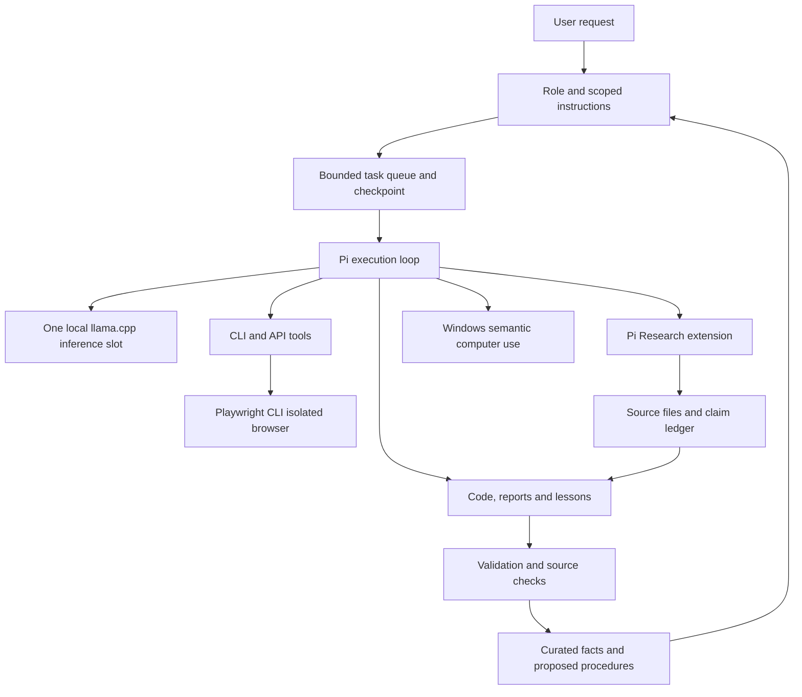

# Architecture lessons: Claude Code, Hermes, and Grok Bot

Research date: 2026-10-21. This is a design study for Pi on a 16 GB Windows PC. It does not recommend installing three other agent products. CLI/API integrations are preferred when they provide equivalent functionality; MCP remains an interoperability fallback.

## Evidence and historical scope

For Claude Code, selected files were read from the [Cohesion97 mirror](https://github.com/Cohesion97/claude-code-source-code/tree/54f5f28699986436547090aba6659f4dab330042), commit `54f5f28699986436547090aba6659f4dab330042`, dated March 31, 2026. The mirror identifies its source as the npm 2.1.88 source map. The [official release tag](https://github.com/anthropics/claude-code/releases/tag/v2.1.88) establishes the release identity. The mirror was not independently compared byte-for-byte with an original npm source map. Code presence, runtime enablement, and public availability are separate claims.

For Hermes, selected first-party source/docs were read at ref `7dcb1b4cfdb88fe870aab3b4fe13041a11207d15`. This is an October 2026 snapshot, not a March reconstruction. Hermes includes an agent runtime/harness as well as a broader application: it is useful here for memory, session and lifecycle design. [Architecture map](https://hermes-agent.nousresearch.com/docs/developer-guide/architecture).

Grok Bot is studied through official product/design documentation. No first-party server implementation was inspected. Internal VM/gateway details inferred by third-party reverse engineering are excluded from verified findings. Source snapshots remain ignored under `.state/source-review`; this repository contains original notes and links, with no vendored Claude source.

## Claude Code: the useful baseline is a runtime, not just a tool list

### 1. Execution has concurrency semantics

The inspected [StreamingToolExecutor](https://github.com/Cohesion97/claude-code-source-code/blob/54f5f28699986436547090aba6659f4dab330042/src/services/tools/StreamingToolExecutor.ts) validates inputs before deciding concurrency. Tools marked safe can overlap; exclusive tools wait. Results are buffered in request order. Cancellation distinguishes user interruption, failed siblings and abandoned streaming attempts. The companion [orchestration code](https://github.com/Cohesion97/claude-code-source-code/blob/54f5f28699986436547090aba6659f4dab330042/src/services/tools/toolOrchestration.ts) groups calls by concurrency safety.

**Pi design inference:** separate inference concurrency from I/O concurrency. One GPU generation at a time can coexist with bounded independent HTTP fetches. Serialize actions on the same browser, desktop input resource or file. A tool failure should produce a structured result and clear downstream cancellation, not an invented success. Do not implement another scheduler until Pi's existing behavior has been measured.

### 2. Task lifecycle is a feature

The mirrored [AgentTool](https://github.com/Cohesion97/claude-code-source-code/blob/54f5f28699986436547090aba6659f4dab330042/src/tools/AgentTool/AgentTool.tsx) exposes background work, optional model selection and worktree isolation. Forking and other behaviors have additional gates. The value is explicit ownership, observable status, durable results and cancellation—not merely the ability to launch another prompt.

**Pi design inference:** a future child-task record needs an ID, objective, exact local model, input artifacts, owned paths, state, result artifact and cancellation outcome. Use sequential child inference on this machine. Worktrees isolate concurrent edits; they do not sandbox arbitrary executable code.

### 3. Context management needs recovery limits

The inspected [autoCompact](https://github.com/Cohesion97/claude-code-source-code/blob/54f5f28699986436547090aba6659f4dab330042/src/services/compact/autoCompact.ts) distinguishes usable context from reserved output, tracks failures, and stops repeated failed compaction after a bounded count. It also has gated alternatives. Its numeric budgets were designed for a different model/runtime; copying them into a 16k local context would be inappropriate.

**Pi design inference:** retain raw evidence on disk, summarize only the active working set, and stop compaction when it makes no progress. An error loop is a lifecycle bug even if every individual model call is valid. Measure prompt prefill and cache reuse alongside generation speed.

### 4. The tool registry exposes a much broader workflow

The mirrored [registry](https://github.com/Cohesion97/claude-code-source-code/blob/54f5f28699986436547090aba6659f4dab330042/src/tools.ts) contains file/shell/search tools, notebook edits, skills, structured user questions, plan transitions, task output/stop and conditional task/team/worktree/LSP/browser surfaces. It applies enablement and deny filtering; some imports are explicitly internal or feature-gated.

**Historical conclusion:** the snapshot supports a substantial harness baseline. It does **not** prove that every registry entry was available to every March 2026 customer. In particular, proactive/KAIROS/trigger code should be treated as gated capability evidence, not a shipped-feature checklist.

### 5. Memory consolidation is a separate job

The mirrored [autoDream implementation](https://github.com/Cohesion97/claude-code-source-code/blob/54f5f28699986436547090aba6659f4dab330042/src/services/autoDream/autoDream.ts) schedules a forked consolidation job using time/session conditions and a cross-process lock. Completion/failure are tracked as task states. Availability remains subject to surrounding gates.

**Pi design inference:** propose durable notes after a successful task; consolidate them in a bounded explicit maintenance job. Preserve source/provenance and avoid rewriting raw research. Background “learning” is additional inference, not free training or updated model weights.

## Hermes: separate kinds of memory and make state inspectable

### Curated memory, procedures and history have different jobs

[memory_tool.py](https://github.com/NousResearch/hermes-agent/blob/7dcb1b4cfdb88fe870aab3b4fe13041a11207d15/tools/memory_tool.py) distinguishes agent notes from user information, uses bounded stores, and supports targeted updates and staged approvals. [skills_tool.py](https://github.com/NousResearch/hermes-agent/blob/7dcb1b4cfdb88fe870aab3b4fe13041a11207d15/tools/skills_tool.py) lists short metadata before exposing full instructions and supporting files. The [state store](https://github.com/NousResearch/hermes-agent/blob/main/hermes_state.py) documents SQLite history/search and session relationships.

**Pi design inference:** keep a tiny user/preferences file, topic-specific evidence, reusable procedures and searchable transcripts as separate stores. Retrieve history on demand. A transcript is not automatically a verified memory; a successful one-off answer is not automatically a reusable procedure. Plain Markdown plus an index is sufficient initially; add SQLite/FTS when retrieval demands it.

### Context accounting should carry provenance

The inspected [compression documentation](https://github.com/NousResearch/hermes-agent/blob/7dcb1b4cfdb88fe870aab3b4fe13041a11207d15/website/docs/developer-guide/context-compression-and-caching.md) describes layered context handling and provider token anchors with estimated appended deltas. It distinguishes measured limits from fallback estimates and bounds reactive recovery.

**Pi design inference:** record whether a token count or context limit is server-reported, configured or estimated. Changing models invalidates assumptions. Keep output truncation, evidence storage and compaction separate: a short display result can still have a full artifact available for later inspection.

### Job success and result delivery are separate outcomes

The inspected [cron internals](https://github.com/NousResearch/hermes-agent/blob/7dcb1b4cfdb88fe870aab3b4fe13041a11207d15/website/docs/developer-guide/cron-internals.md) distinguish an executed job from queued, delivered or failed delivery and use execution IDs for write-back. No scheduling system was installed here.

**Pi design inference:** an overnight local research run should save its report even if a desktop notification fails. A future Windows scheduler should launch a bounded task with an execution ID, output directory and resume checkpoint. It should not repeat completed external actions just because notification status is uncertain.

## Grok Bot: persistent responsibility around the execution loop

The official [design article](https://x.ai/news/designing-grok-bot) distinguishes persistent Bot identity, conversations, reusable instructions, execution tools and durable artifacts. It assigns memory/routines to an enduring role and makes work state visible. The [launch post](https://x.ai/news/introducing-grok-bot) describes shared cloud-computer access and agent coordination. These are product-level guarantees, not evidence of a particular backend implementation.

The official [skills/routines guide](https://docs.x.ai/grok-bot/skills-routines-and-automations) recommends making a one-time process reliable, capturing its method, then scheduling it. Demonstration-derived procedures need review and failure rules. Routine ownership, current inputs, stale-data handling and validation are explicit concerns.

**Pi design inference:** create durable roles such as Researcher, Tutor and Builder, with shared procedures but scoped working memory. Their identity does not require three simultaneously loaded models. For local desktop work, use exclusive ownership of physical input and a clear human takeover state. Prefer CLI/API execution where equivalent; record a reproducible script from a successful GUI workflow when possible. Unattended routines need an awake machine and an actual local scheduler; a local agent cannot keep running on a powered-off PC.

## Proposed Pi system design

This is a proposed design. Only the installed tools and checks documented in `evaluation/SETUP-2026-10-21.md` are implemented.

| Capability | Implementation direction | Priority |
|---|---|---|
| Browser operations | Pinned Playwright CLI, explicit sessions | Now |
| Research and desktop tools | Pinned native Pi extensions | Now; model/GUI task validation follows |
| Facts vs procedures vs evidence | Separate Markdown locations and provenance | Next workflow improvement |
| Durable task records | Small explicit files before a new database | After baseline task tests |
| Child ownership/cancellation | Existing Pi extension, one inference slot | After profile compatibility tests |
| History search | Existing sessions plus bounded search/index | Add when retrieval is a demonstrated need |
| Long-job recovery | Checkpoint + execution ID + artifact path | Before unattended workloads |
| Background consolidation | Explicit bounded review job | Later; no invisible memory rewrites |
| Scheduled execution | Windows scheduler only after a reliable manual workflow | Later; not authorized/created by this research request |

The design goal is reliable completion and retained knowledge. Tool count, agent count and source-code size are weak proxies for that outcome.
